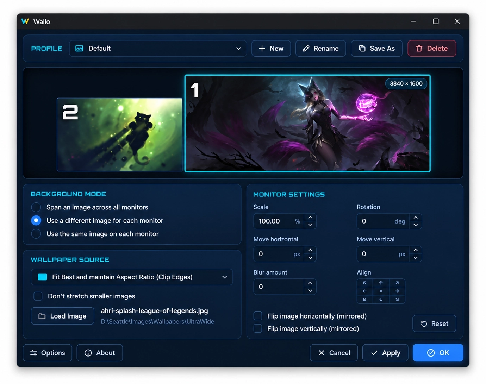

# Wallo

[](https://github.com/dragonofmercy/wallo/releases/latest)
[](https://github.com/dragonofmercy/wallo/releases)
[](LICENSE)
[](https://tauri.app/)
[](https://www.microsoft.com/windows)
[](https://ko-fi.com/dragonofmercy)

A lightweight wallpaper manager for Windows 10 and 11 with multiple monitors.



Wallo does what the Windows settings can't: put a different image on each screen, stretch one image across all of them, and fine-tune how each image is placed. Pick your settings, click **Apply**, and Wallo tucks itself into the notification area, where switching profiles takes one click.

## Features

- **Profiles** - save several wallpaper setups and switch between them in one click.
- **Three modes**
  - one image spanned across all monitors
  - a different image on each monitor
  - the same image repeated on every monitor
- **Sizing** - Center, Stretch, Fit (with or without cropping), Fit Width, Fit Height, Tile, plus an option to never enlarge small images.
- **Per-monitor adjustments** - scale, rotation, horizontal and vertical offset, blur, horizontal and vertical mirror.
- **Align** - snap the image to any edge, corner or the center of the screen in one click, even after scaling or rotating it.
- **Live preview** of every monitor, laid out like your real screens.
- **Tray icon** - right-click it to apply any profile instantly, left-click to open Wallo. The window is fully unloaded when closed, so Wallo stays light in the background.
- **Start with Windows** (optional) - Wallo starts in the tray at logon.
- **Automatic updates** - when a new version is out, a banner offers to install it when you open the window. Nothing is installed without your click, and no network means no banner.

## Usage

1. Choose a profile at the top, or create one with **New**.
2. Pick a background mode.
3. In "Use a different image for each monitor" mode, click a monitor in the preview to select it.
4. Click **Load Image** (it opens in the folder of the current image), then adjust sizing and settings. Use the **Align** pad to snap the image to an edge after scaling it. The preview updates as you go.
5. Click **Apply** to set the wallpaper, or **OK** to apply and close.

**Cancel** closes the window without saving your changes. Wallo keeps running in the tray; use **Quit** in the tray menu to exit it.

## Where things are stored

- Profiles: `%APPDATA%\com.wallo.app\profiles.json`
- Generated wallpapers: `%APPDATA%\com.wallo.app\rendered\`
- Window position: `%APPDATA%\com.wallo.app\.window-state.json`

Your original images are never modified.

## Requirements

- Windows 10 or 11
- Microsoft Edge WebView2 Runtime (already included in Windows 11 and up-to-date Windows 10)

## Building from source

Requires [Rust](https://rustup.rs), [Node.js](https://nodejs.org) and the Tauri CLI (`cargo install tauri-cli`).

```
.\build.ps1
```

It installs the npm dependencies if needed, then runs `cargo tauri build`. The MSI and NSIS installers are written to `src-tauri\target\release\bundle\`.

`build.ps1` signs the update files with the maintainer's key (`..\keys\updater.key`, not in the repo). Without it, build unsigned:

```
cargo tauri build --config '{\"bundle\":{\"createUpdaterArtifacts\":false}}'
```

## Releasing

1. List the changes under `## [Unreleased]` in `CHANGELOG.md`.
2. From `main` with a clean tree, run `.\release.ps1 1.0.0`.

It sets the version in `src-tauri\Cargo.toml` (the only place it lives), dates the changelog section, builds, commits, tags `v1.0.0`, pushes, and publishes the GitHub release with both installers and `latest.json`, the file the in-app updater reads.

## Support

If this project helps to increase your productivity, you can give me a cup of coffee :)

<a href="https://ko-fi.com/dragonofmercy"></a>

## License

MIT
